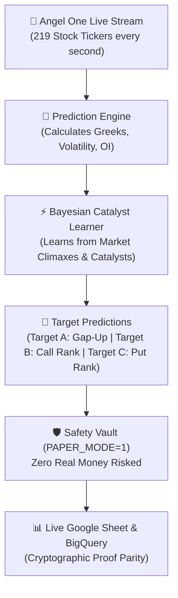
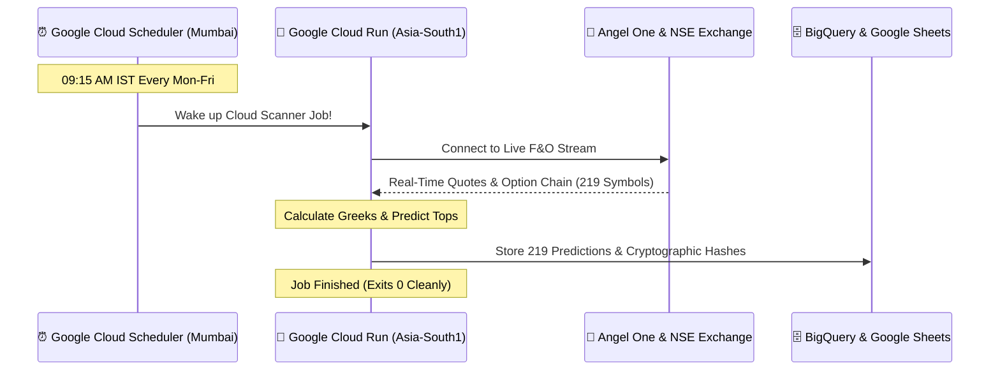
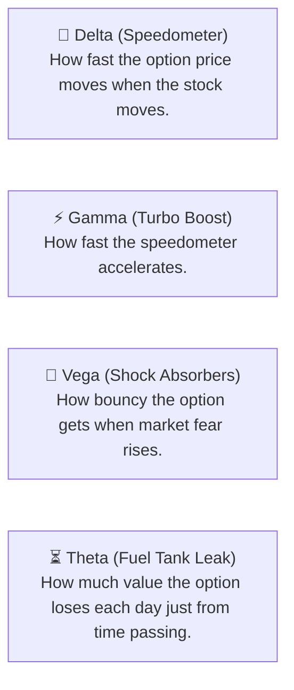
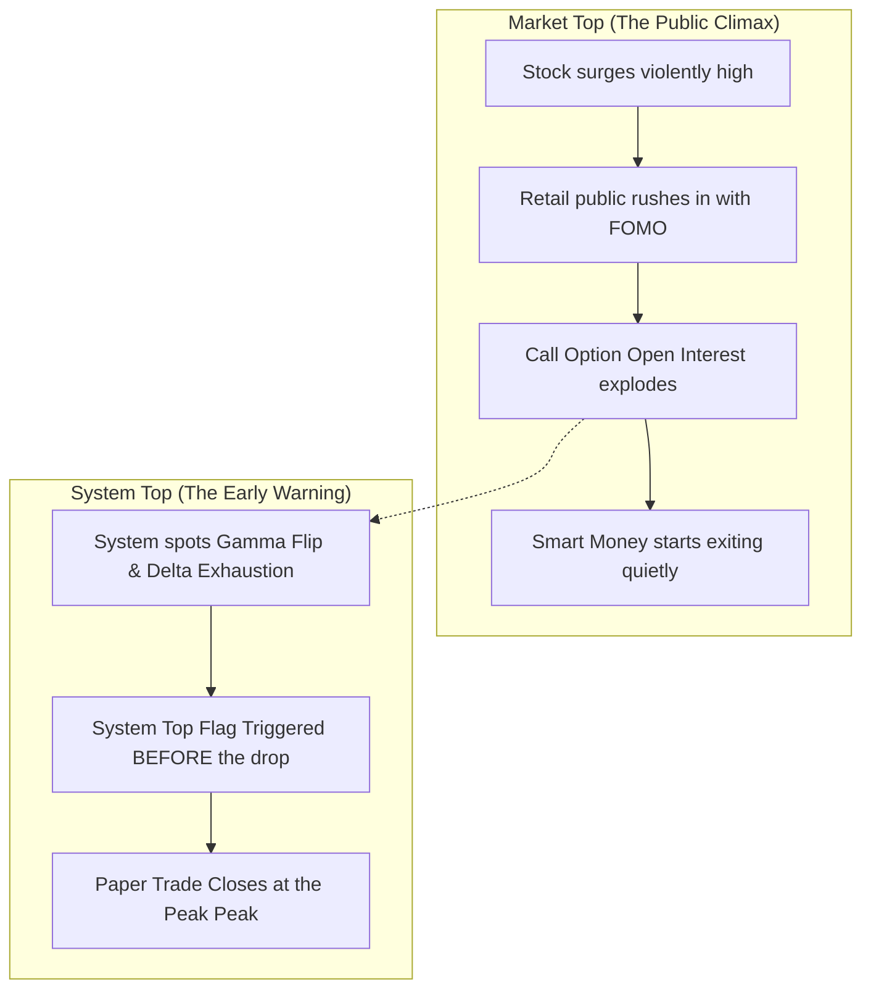
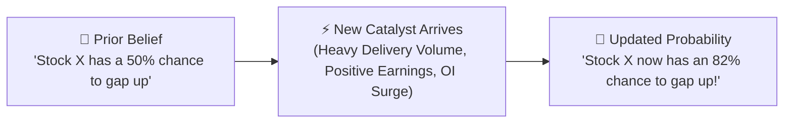

# 🌟 The Angel F&O Prediction & Paper Trading System
## *A Simple, Kid-Friendly Visual Guide for the Owner*

---

> [!NOTE]
> **What this document is:** A plain-language guide explaining how your autonomous trading engine works, how it learns, why it is 100% safe, and how it runs in Google Cloud even when your laptop is turned off!

---

## 🧭 1. The Big Picture: How Everything Works Together

Think of your trading system like a **super-smart weather forecast for the stock market**:

---

## ☁️ 2. The Cloud Brain: How It Runs When Your Laptop Is Off

You do **not** need to keep your laptop awake or plugged in for the scanner to work!

1. **Cloud Scheduler** in Mumbai triggers at **09:15 AM IST** every weekday.
2. **Cloud Run** spins up in Google's secure Mumbai data center.
3. It connects to the **Angel One SmartAPI**, processes all 219 F&O stocks, and predicts which ones will rise.
4. It records the predictions into **BigQuery** and **Google Sheets**.
5. Your laptop can be completely shut down, in sleep mode, or travelling without Wi-Fi!

---

## 🛡️ 3. The Iron Safety Locks: Why Your Money Is 100% Safe

Your system has two unbreakable electronic padlocks permanently welded into the code:

| Padlock Name | Setting | What It Means |
| :--- | :--- | :--- |
| `PAPER_MODE` | `= 1` | All trades are **simulated practice trades** written to a digital ledger. |
| `LIVE_ORDER_AUTHORITY` | `= 0` | The system is physically forbidden from placing real orders with real money. |

Even if the market goes crazy, **zero rupees of real money can ever be placed on an exchange**.

---

## 🧮 4. The 4 Option Greeks Explained Like a Car

Options sound complicated, but they work just like parts of a car:

1. **Delta ($\Delta$)**: If the stock moves up by ₹1, Delta tells you how many paise your option gains.
2. **Gamma ($\Gamma$)**: The acceleration! High Gamma means a small rise can turn into a massive multibagger.
3. **Vega ($\mathcal{V}$)**: Market excitement and fear. When results or budgets come, Vega pumps up option premiums.
4. **Theta ($\Theta$)**: The clock ticking. Every night that passes, options lose a little time value.

---

## 🏔️ 5. Market Top vs. System Top: Catching the Highest Point

Most traders make the mistake of waiting until a stock is already falling before they sell. Your system does the opposite:

* **What is a Market Top?** The absolute highest price a stock reaches before sellers take over.
* **What is a System Top?** An mathematical signal triggered **right before** the peak by watching:
  * **Option Gamma Flipping**: Market makers running out of hedging demand.
  * **Put-Call Ratio (PCR) Divergence**: When price makes a new high, but options volume refuses to confirm.
  * **Call Writing Wall**: Huge institutions setting a ceiling by selling call options.

When the System Top triggers, the simulated paper trade exits at maximum profit!

---

## 🧠 6. Dynamic Bayesian Learning: How the System Learns

The system does not just use static rules. It uses **Bayesian Probability Updating**, which works like learning from experience:

1. **Morning Prior**: Based on historical 1-year backtests.
2. **Live Catalysts**:
   * **Open Interest (OI) Spike**: Big institutional money entering.
   * **Implied Volatility (IV) Skew**: Options traders pricing in a violent move.
   * **Sector Momentum**: If 8 out of 10 IT stocks are flying, the remaining 2 get an automatic probability boost!
3. **Self-Adjusting**: If a prediction misses, the system immediately downgrades that catalyst pattern so it doesn't make the same mistake twice.

---

## 📊 7. Live Ledger & The 219 Stocks Parity

Every morning, the system reconciles 219 F&O stocks across two databases:
* **Google Sheets**: For you to view easily on your phone or computer.
* **Google BigQuery**: Enterprise-grade cloud warehouse for long-term historical archives.

Both systems match **100% symbol-for-symbol with cryptographic SHA-256 validation**.

---

## 🚀 8. How to Open the Dynamic Google Colab Notebook

You have an interactive Google Colab Notebook ready:
1. Open the file: [`notebooks/AngelFNO_Live_Intelligence_Guide.ipynb`](file:///C:/AngelFNO_Workstation/repos/angel-fno-scanner/notebooks/AngelFNO_Live_Intelligence_Guide.ipynb)
2. In Google Colab, simply click **Runtime ➔ Run all**.
3. It will automatically load the live data, display colorful charts, show today's Top 5 Gap-Up candidates, and display the live paper trading ledger!
