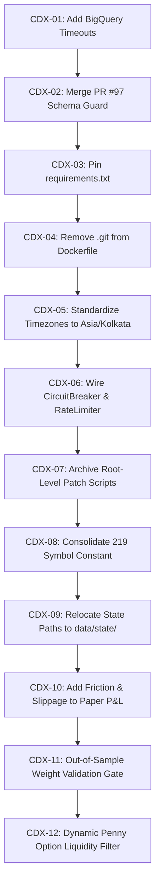

# Codex Implementation Backlog: Angel F&O Scanner

> **Target File Location:** `C:\Temp\AngelFNO\CODEX_IMPLEMENTATION_BACKLOG.md`  
> **Repository:** `psw2025-cmd/angel-fno-scanner`  
> **Governing Operating Contract:** [`AGENTS.md`](file:///C:/AngelFNO_Workstation/repos/angel-fno-scanner/AGENTS.md)  
> **Target Environment:** Python 3.12.10, BigQuery (`fno-angel-prod-1790444589.fno_predictions`), Google Sheets (`OPTION_SHEET`), GitHub Actions, Cloud Run  
> **Trading Safety Policy:** `PAPER / ANALYZER = ON` | `LIVE ORDER AUTHORITY = OFF` | `REAL BROKER ORDERS = 0`  
> **Execution Model:** Strict sequential progression. Each task is self-contained with exact file paths, code diffs, regression test commands, rollback instructions, and dependency chains.

---

## Executive Summary & Dependency Flow

The following 12 work items must be executed in strict sequence. Each task builds on the stability and invariants established by its predecessor.



---

## Sequential Implementation Tasks

### Task CDX-01: Add Explicit Timeouts to BigQuery `job.result()` Calls

- **Priority:** P1 (High)
- **Estimated Complexity:** Low (1 hour / 1 Story Point)
- **Dependencies:** None (First task in execution queue)
- **Affected Files:**
  - [`angel_prediction_engine.py:1379`](file:///C:/AngelFNO_Workstation/repos/angel-fno-scanner/angel_prediction_engine.py#L1379)
  - [`angel_prediction_engine.py:1533`](file:///C:/AngelFNO_Workstation/repos/angel-fno-scanner/angel_prediction_engine.py#L1533)
  - [`angel_prediction_engine.py:2684`](file:///C:/AngelFNO_Workstation/repos/angel-fno-scanner/angel_prediction_engine.py#L2684)

#### Root Cause
In `angel_prediction_engine.py`, BigQuery `.result()` is invoked on load jobs without a `timeout` argument. During Google Cloud API congestion, network partitions, or socket hangs, the worker blocks indefinitely. This violates the zero-silent-failure SLA and can cause GitHub Actions runners and Cloud Run jobs to hit external execution timeouts without capturing failure telemetry.

#### Required Change
1. Import `concurrent.futures` and `google.api_core.exceptions.GoogleAPICallError` in [`angel_prediction_engine.py`](file:///C:/AngelFNO_Workstation/repos/angel-fno-scanner/angel_prediction_engine.py).
2. Configure a default timeout constant `DEFAULT_BQ_TIMEOUT_SECONDS = int(os.getenv("BQ_LOAD_TIMEOUT_SECONDS", "60"))`.
3. Wrap all `.result()` calls with `timeout=DEFAULT_BQ_TIMEOUT_SECONDS`.
4. On timeout or API error, catch the exception, invoke [`scanner.py:write_local_backup_buffer()`](file:///C:/AngelFNO_Workstation/repos/angel-fno-scanner/scanner.py#L36-L60) to prevent data loss, and raise `RuntimeError`.

```python
# angel_prediction_engine.py: Replacement for Lines 1378-1380
import concurrent.futures
from google.api_core.exceptions import GoogleAPICallError

DEFAULT_BQ_TIMEOUT_SECONDS = int(os.getenv("BQ_LOAD_TIMEOUT_SECONDS", "60"))

try:
    job = bq_client.load_table_from_json(bq_rows, table, job_config=job_config)
    job.result(timeout=DEFAULT_BQ_TIMEOUT_SECONDS)
    print(f"[OK] Loaded {len(bq_rows)} next-day gap records into BigQuery next_day_gap_predictions!")
except concurrent.futures.TimeoutError as exc:
    print(f"[ERROR] BigQuery next_day_gap_predictions load job timed out after {DEFAULT_BQ_TIMEOUT_SECONDS}s: {exc}")
    try:
        from scanner import write_local_backup_buffer
        write_local_backup_buffer(BQ_DATASET_ID, "next_day_gap_predictions", bq_rows)
    except Exception as buffer_err:
        print(f"[CRITICAL] Fallback buffer failed: {buffer_err}")
    raise RuntimeError(f"BigQuery load job timed out after {DEFAULT_BQ_TIMEOUT_SECONDS}s") from exc
except GoogleAPICallError as exc:
    print(f"[ERROR] BigQuery API call error: {exc}")
    try:
        from scanner import write_local_backup_buffer
        write_local_backup_buffer(BQ_DATASET_ID, "next_day_gap_predictions", bq_rows)
    except Exception as buffer_err:
        print(f"[CRITICAL] Fallback buffer failed: {buffer_err}")
    raise
```

#### Validation Steps
```powershell
# 1. Run unit tests covering prediction engine
python -m pytest tests/test_prediction_engine.py -v

# 2. Execute dry-run import verification
python -c "import angel_prediction_engine; print('Timeout logic loaded cleanly')"
```

#### Rollback Plan
If tests fail or BigQuery mock client rejects the timeout argument, revert edits to [`angel_prediction_engine.py`](file:///C:/AngelFNO_Workstation/repos/angel-fno-scanner/angel_prediction_engine.py) using git:
```bash
git checkout HEAD -- angel_prediction_engine.py
```

---

### Task CDX-02: Merge & Verify PR #97 Live Schema Guard (Float to Int64 Coercion)

- **Priority:** P1 (High)
- **Estimated Complexity:** Low (1 hour / 1 Story Point)
- **Dependencies:** Task CDX-01
- **Affected Files:**
  - [`tools/live_schema_guard.py`](file:///C:/AngelFNO_Workstation/repos/angel-fno-scanner/tools/live_schema_guard.py)
  - [`angel_prediction_engine.py:2551-2688`](file:///C:/AngelFNO_Workstation/repos/angel-fno-scanner/angel_prediction_engine.py#L2551-L2688) (`sync_to_bigquery`)
  - [`tests/test_schema_validator.py`](file:///C:/AngelFNO_Workstation/repos/angel-fno-scanner/tests/test_schema_validator.py)

#### Root Cause
In `fno_predictions.market_news_sentiment`, BigQuery schemas enforce INT64 on sentiment counter and cycle fields. Python's floating-point math generates float representations (e.g. `1.0`), causing BigQuery load jobs to abort with `400 Invalid value for field ... expected type INT64 but got FLOAT`. Open PR #97 contains the fix in `tools/live_schema_guard.py`.

#### Required Change
1. Fetch and merge `origin/fix/live-schema-guard-float-int64` (PR #97).
2. Ensure [`tools/live_schema_guard.py`](file:///C:/AngelFNO_Workstation/repos/angel-fno-scanner/tools/live_schema_guard.py) casts float values destined for INT64 columns to `int(round(val))`.
3. In `angel_prediction_engine.py:sync_to_bigquery()`, ensure every dictionary row is sanitized via `enforce_live_schema_types(table_id, row)` before being submitted to BigQuery.

```python
# Ensure tools/live_schema_guard.py contains:
def sanitize_bq_row(table_name: str, row: dict) -> dict:
    sanitized = dict(row)
    int_fields = {"cycle_number", "article_count", "bullish_count", "bearish_count", "neutral_count", "rank"}
    for k, v in sanitized.items():
        if k in int_fields and v is not None:
            try:
                sanitized[k] = int(round(float(v)))
            except (ValueError, TypeError):
                sanitized[k] = 0
    return sanitized
```

#### Validation Steps
```powershell
# 1. Verify schema validator test suite
python -m pytest tests/test_schema_validator.py tests/test_infra_readiness.py -v

# 2. Run simulation test checking float-to-int coercion
python -c "from tools.live_schema_guard import sanitize_bq_row; res = sanitize_bq_row('market_news_sentiment', {'cycle_number': 4.0, 'title': 'test'}); assert isinstance(res['cycle_number'], int); print('Schema guard OK')"
```

#### Rollback Plan
If merge conflicts or schema test regressions occur:
```bash
git merge --abort
git checkout main
```

---

### Task CDX-03: Dependency Pinning & Supply-Chain Hardening in `requirements.txt`

- **Priority:** P1 (High)
- **Estimated Complexity:** Low (1 hour / 1 Story Point)
- **Dependencies:** Task CDX-02
- **Affected Files:**
  - [`requirements.txt:1-11`](file:///C:/AngelFNO_Workstation/repos/angel-fno-scanner/requirements.txt#L1-L11)

#### Root Cause
Only `smartapi-python==1.5.5` is pinned. Floating dependencies (`gspread`, `google-cloud-bigquery`, `pycryptodome`, etc.) allow upstream package managers to install untested major releases during GitHub Actions runs or container builds, exposing the pipeline to breaking changes.

#### Required Change
Update [`requirements.txt`](file:///C:/AngelFNO_Workstation/repos/angel-fno-scanner/requirements.txt) to pin exact, verified production package versions:

```text
smartapi-python==1.5.5
logzero==1.7.0
websocket-client==1.8.0
pycryptodome==3.20.0
pyotp==2.9.0
gspread==6.1.2
google-cloud-bigquery==3.25.0
pytz==2024.1
tzdata==2024.1
requests==2.32.3
```

#### Validation Steps
```powershell
# 1. Test installation dry-run
pip install --dry-run -r requirements.txt

# 2. Confirm runtime import of all packages
python -c "import SmartApi, gspread, google.cloud.bigquery, pyotp, requests, logzero; print('All pinned dependencies imported successfully')"

# 3. Run entire test suite to ensure compatibility
python -m pytest tests/test_credentials_architecture.py -v
```

#### Rollback Plan
Revert `requirements.txt` to the prior unpinned file if any package installation conflict is detected:
```bash
git checkout HEAD -- requirements.txt
```

---

### Task CDX-04: Container Hardening: Eliminate `.git` Directory in Docker Image

- **Priority:** P1 (High)
- **Estimated Complexity:** Low (1 hour / 1 Story Point)
- **Dependencies:** Task CDX-03
- **Affected Files:**
  - [`Dockerfile.cloudrun:12-19`](file:///C:/AngelFNO_Workstation/repos/angel-fno-scanner/Dockerfile.cloudrun#L12-L19)
  - [`.dockerignore`](file:///C:/AngelFNO_Workstation/repos/angel-fno-scanner/.dockerignore)
  - [`tools/cycle_provenance.py:20-45`](file:///C:/AngelFNO_Workstation/repos/angel-fno-scanner/tools/cycle_provenance.py#L20-L45)

#### Root Cause
[`Dockerfile.cloudrun:13`](file:///C:/AngelFNO_Workstation/repos/angel-fno-scanner/Dockerfile.cloudrun#L13) contains `COPY .git .git`. This copies the full repository commit history into the production Cloud Run image, bloating image size by over 80MB and exposing internal commit logs and author metadata.

#### Required Change
1. Remove `COPY .git .git` from `Dockerfile.cloudrun`.
2. Add `.git` and `.github` to `.dockerignore`.
3. In `Dockerfile.cloudrun`, inject `ARG SOURCE_COMMIT=unknown` and write it to `/app/SOURCE_COMMIT` and environment variable `GIT_SHA`.
4. Ensure [`tools/cycle_provenance.py`](file:///C:/AngelFNO_Workstation/repos/angel-fno-scanner/tools/cycle_provenance.py) checks `/app/SOURCE_COMMIT` and `os.getenv("GIT_SHA")` before executing `git rev-parse HEAD`.

```dockerfile
# Dockerfile.cloudrun around lines 12-20
COPY . .

ARG SOURCE_COMMIT=unknown
ENV GIT_SHA=$SOURCE_COMMIT
RUN printf '%s\n' "$SOURCE_COMMIT" > /app/SOURCE_COMMIT \
    && useradd --create-home --shell /bin/bash scanner \
    && chown -R scanner:scanner /app
USER scanner
```

#### Validation Steps
```powershell
# 1. Verify cycle provenance resolves commit from environment without .git
python -c "import os; os.environ['GIT_SHA']='a1b2c3d4e5'; from tools.cycle_provenance import resolve_git_sha; assert resolve_git_sha() == 'a1b2c3d4e5'; print('Provenance fallback OK')"

# 2. Run provenance tests
python -m pytest tests/test_cycle_provenance_and_lease.py tests/test_atomic_provenance.py -v
```

#### Rollback Plan
Restore original `Dockerfile.cloudrun` using git:
```bash
git checkout HEAD -- Dockerfile.cloudrun .dockerignore
```

---

### Task CDX-05: Standardize Timezone-Aware Datetimes Across Scanner and Engine

- **Priority:** P1 (High)
- **Estimated Complexity:** Medium (2 hours / 2 Story Points)
- **Dependencies:** Task CDX-04
- **Affected Files:**
  - [`scanner.py:113-115`](file:///C:/AngelFNO_Workstation/repos/angel-fno-scanner/scanner.py#L113-L115), [`L136-148`](file:///C:/AngelFNO_Workstation/repos/angel-fno-scanner/scanner.py#L136-L148)
  - [`angel_prediction_engine.py:109-111`](file:///C:/AngelFNO_Workstation/repos/angel-fno-scanner/angel_prediction_engine.py#L109-L111)
  - [`writer_guard.py:8-15`](file:///C:/AngelFNO_Workstation/repos/angel-fno-scanner/writer_guard.py#L8-L15)

#### Root Cause
[`scanner.py:114`](file:///C:/AngelFNO_Workstation/repos/angel-fno-scanner/scanner.py#L114) defines `now_ist()` as `datetime.datetime.now(IST).replace(tzinfo=None)`. Stripping timezone info causes silent `TypeError: can't compare offset-naive and offset-aware datetimes` when interacting with [`angel_prediction_engine.py`](file:///C:/AngelFNO_Workstation/repos/angel-fno-scanner/angel_prediction_engine.py), which uses timezone-aware datetimes.

#### Required Change
1. In `scanner.py`, update `now_ist()` to return a timezone-aware datetime:
```python
def now_ist() -> datetime.datetime:
    return datetime.datetime.now(IST)
```
2. Update `heartbeat_age_seconds(book, now)` to ensure both the current timestamp and cell timestamp are converted to timezone-aware IST before calculating `total_seconds()`:
```python
def heartbeat_age_seconds(book, now=None):
    if now is None:
        now = now_ist()
    if now.tzinfo is None:
        now = now.replace(tzinfo=IST)
    try:
        stamped = book.worksheet("HEARTBEAT").acell("A2").value
    except gspread.WorksheetNotFound:
        return None
    if not stamped:
        return None
    try:
        wrote = datetime.datetime.strptime(str(stamped).strip()[:19], "%Y-%m-%d %H:%M:%S").replace(tzinfo=IST)
    except ValueError:
        return None
    return max(0.0, (now - wrote).total_seconds())
```

#### Validation Steps
```powershell
# 1. Run timestamp contract tests
python -m pytest tests/test_timestamp_contract.py tests/test_heartbeat_bq_sync_column.py -v

# 2. Verify interactive datetime comparison
python -c "import scanner; now = scanner.now_ist(); assert now.tzinfo is not None; print('Timezone-aware now_ist() verified:', now)"
```

#### Rollback Plan
```bash
git checkout HEAD -- scanner.py
```

---

### Task CDX-06: Wire `circuit_breaker.py` and `rate_limiter.py` into Quote Loop

- **Priority:** P1 (High)
- **Estimated Complexity:** Medium (3 hours / 3 Story Points)
- **Dependencies:** Task CDX-05
- **Affected Files:**
  - [`scanner.py:281-306`](file:///C:/AngelFNO_Workstation/repos/angel-fno-scanner/scanner.py#L281-L306) (`fetch_chunked`)
  - [`circuit_breaker.py`](file:///C:/AngelFNO_Workstation/repos/angel-fno-scanner/circuit_breaker.py)
  - [`rate_limiter.py`](file:///C:/AngelFNO_Workstation/repos/angel-fno-scanner/rate_limiter.py)

#### Root Cause
`circuit_breaker.py` and `rate_limiter.py` were built and tested in unit tests, but are not invoked in [`scanner.py:fetch_chunked()`](file:///C:/AngelFNO_Workstation/repos/angel-fno-scanner/scanner.py#L281-L306). The live loop relies solely on primitive `time.sleep(0.35)`. Consecutive broker errors fail to trip a circuit breaker, risking IP or API key throttling by Angel One.

#### Required Change
1. Import `CircuitBreaker` from `circuit_breaker.py` and `RateLimiter` from `rate_limiter.py`.
2. Instantiate `smartapi_breaker = CircuitBreaker(failure_threshold=4, recovery_timeout=45.0, name="SmartAPI_MarketData")`.
3. Instantiate `smartapi_limiter = RateLimiter(max_calls=3, period=1.0)`.
4. Wrap `api.getMarketData("FULL", ...)` inside `smartapi_breaker.call(...)` with `smartapi_limiter.acquire()`.
5. If breaker state is `OPEN`, fail closed gracefully, keep existing sheet content untouched, and log warning.

```python
# In scanner.py around line 281:
from circuit_breaker import CircuitBreaker
from rate_limiter import RateLimiter

smartapi_breaker = CircuitBreaker(failure_threshold=4, recovery_timeout=45.0, name="SmartAPI_MarketData")
smartapi_limiter = RateLimiter(max_calls=3, period=1.0)

def fetch_chunked(api, tokens, size=45):
    quotes = {}
    failures = 0
    for start in range(0, len(tokens), size):
        chunk = tokens[start:start + size]
        smartapi_limiter.acquire()

        def _fetch():
            res = api.getMarketData("FULL", {"NFO": chunk})
            if not res or not res.get("status"):
                raise RuntimeError(f"Market data failed for {len(chunk)} tokens: {res}")
            return res

        for attempt in range(4):
            try:
                response = smartapi_breaker.call(_fetch)
                for item in response.get("data", {}).get("fetched", []) or []:
                    quotes[str(item.get("symbolToken"))] = item
                break
            except Exception as exc:
                if attempt == 3:
                    failures += 1
                    print(f"[ERROR] Quote chunk failed permanently: {exc}")
                else:
                    backoff = (2 ** attempt) + 0.5
                    time.sleep(backoff)
    return quotes, failures
```

#### Validation Steps
```powershell
# 1. Run unit tests for rate limiter and circuit breaker
python -m pytest tests/test_circuit_breaker.py tests/test_rate_limiter.py tests/test_gainers.py -v

# 2. Verify scanner imports without errors
python -c "import scanner; assert hasattr(scanner, 'smartapi_breaker'); print('Circuit breaker wired OK')"
```

#### Rollback Plan
```bash
git checkout HEAD -- scanner.py
```

---

### Task CDX-07: Archive Root-Level Patch Scripts & Unused Clutter

- **Priority:** P2 (Medium)
- **Estimated Complexity:** Low (1 hour / 1 Story Point)
- **Dependencies:** Task CDX-06
- **Affected Files:**
  - `apply_patches.py`
  - `patch_scanner.py`
  - `patch_engine.py`
  - `fix_infrastructure.py`

#### Root Cause
Temporary scripts used during ad-hoc manual repair sessions remain in the repository root. They contain hardcoded GCP project names and unvalidated string replacement routines that create confusion and risk unintentional execution.

#### Required Change
1. Create directory `tools/archive/`.
2. Move `apply_patches.py`, `patch_scanner.py`, `patch_engine.py`, and `fix_infrastructure.py` into `tools/archive/`.
3. Add a warning docstring at the top of each: `# DEPRECATED: Retained strictly for historical audit trail. Do not execute in production.`
4. Verify root directory is clean of legacy patch files.

#### Validation Steps
```powershell
# 1. Run full test suite to guarantee no production or test code imported from root scripts
python -m pytest -v

# 2. Confirm files are moved
python -c "import os; assert not os.path.exists('apply_patches.py'); assert os.path.exists('tools/archive/apply_patches.py'); print('Archive clean OK')"
```

#### Rollback Plan
```bash
git mv tools/archive/* .
```

---

### Task CDX-08: Consolidate 219 Symbol Constant to Single Source of Truth

- **Priority:** P2 (Medium)
- **Estimated Complexity:** Low (1 hour / 1 Story Point)
- **Dependencies:** Task CDX-07
- **Affected Files:**
  - [`scanner.py:101-103`](file:///C:/AngelFNO_Workstation/repos/angel-fno-scanner/scanner.py#L101-L103)
  - [`universe_contract.py:5`](file:///C:/AngelFNO_Workstation/repos/angel-fno-scanner/universe_contract.py#L5)
  - [`tests/test_infra_readiness.py`](file:///C:/AngelFNO_Workstation/repos/angel-fno-scanner/tests/test_infra_readiness.py)

#### Root Cause
[`scanner.py:103`](file:///C:/AngelFNO_Workstation/repos/angel-fno-scanner/scanner.py#L103) duplicates `EXPECTED_FNO_UNIVERSE_COUNT = 219` to satisfy an old AST probe in `infra_readiness.py`. Duplicating constants creates drift risk if the universe changes in [`universe_contract.py`](file:///C:/AngelFNO_Workstation/repos/angel-fno-scanner/universe_contract.py).

#### Required Change
1. In `scanner.py`, remove the duplicate constant literal and import directly:
```python
from universe_contract import (
    EXPECTED_FNO_UNIVERSE_COUNT,
    require_verified_symbols,
    select_verified_universe,
)
```
2. Update `tests/test_infra_readiness.py` to assert universe count by importing `EXPECTED_FNO_UNIVERSE_COUNT` from `universe_contract.py` or inspect `agent_manifest.json`.

#### Validation Steps
```powershell
python -m pytest tests/test_universe_contract.py tests/test_infra_readiness.py -v
```

#### Rollback Plan
```bash
git checkout HEAD -- scanner.py tests/test_infra_readiness.py
```

---

### Task CDX-09: Relocate Cache and State Files to Dedicated `data/state/` Directory

- **Priority:** P2 (Medium)
- **Estimated Complexity:** Medium (2 hours / 2 Story Points)
- **Dependencies:** Task CDX-08
- **Affected Files:**
  - [`angel_prediction_engine.py:83-87`](file:///C:/AngelFNO_Workstation/repos/angel-fno-scanner/angel_prediction_engine.py#L83-L87)
  - [`scanner.py:41`](file:///C:/AngelFNO_Workstation/repos/angel-fno-scanner/scanner.py#L41)
  - [`.gitignore`](file:///C:/AngelFNO_Workstation/repos/angel-fno-scanner/.gitignore)

#### Root Cause
[`angel_prediction_engine.py:83-86`](file:///C:/AngelFNO_Workstation/repos/angel-fno-scanner/angel_prediction_engine.py#L83-L86) targets user root `~/` (e.g. `~/angel_prediction_state.json`), scattering dynamic JSON state files across arbitrary user home directories. In containers, `/home/scanner/` may lack persistence or cross-session consistency.

#### Required Change
1. Standardize state paths to repository-relative `data/state/` directory with automatic creation:
```python
STATE_DIR = Path(os.getenv("ANGEL_STATE_DIR", Path(__file__).resolve().parent / "data" / "state"))
STATE_DIR.mkdir(parents=True, exist_ok=True)

STATE_PATH = STATE_DIR / "angel_prediction_state.json"
CALIBRATION_STATE_PATH = STATE_DIR / "angel_calibration_state.json"
SCRIP_CACHE_PATH = STATE_DIR / "angel_scrip_cache.json"
NSE_CACHE_PATH = STATE_DIR / "angel_nse_cache.json"
```
2. In `scanner.py:write_local_backup_buffer`, use `Path(tempfile.gettempdir()) / "angel_telemetry_backup"` for cross-platform fallback path compatibility.
3. Add `data/state/*.json` to `.gitignore`.

#### Validation Steps
```powershell
# 1. Verify directory creation and path resolution
python -c "import angel_prediction_engine; print('State dir resolves to:', angel_prediction_engine.STATE_DIR); assert angel_prediction_engine.STATE_DIR.exists()"

# 2. Run test suite
python -m pytest tests/test_prediction_engine.py -v
```

#### Rollback Plan
```bash
git checkout HEAD -- angel_prediction_engine.py scanner.py .gitignore
```

---

### Task CDX-10: Incorporate Slippage & Transaction Costs in Paper Trade P&L

- **Priority:** P2 (Medium)
- **Estimated Complexity:** Medium (3 hours / 3 Story Points)
- **Dependencies:** Task CDX-09
- **Affected Files:**
  - [`angel_prediction_engine.py:1450-1475`](file:///C:/AngelFNO_Workstation/repos/angel-fno-scanner/angel_prediction_engine.py#L1450-L1475) (`reconcile_next_day_gap_trades`)

#### Root Cause
[`angel_prediction_engine.py:1452`](file:///C:/AngelFNO_Workstation/repos/angel-fno-scanner/angel_prediction_engine.py#L1452) calculates paper P&L as `(open_ltp - entry_ltp) / entry_ltp`. It ignores bid/ask spread slippage, exchange turnover charges, STT, and stamp duties. Paper returns appear artificially inflated compared to what an executable order could achieve.

#### Required Change
1. Model realistic market friction:
   - Round-trip bid-ask slippage proxy: 1.50% of premium.
   - Statutory taxes and exchange fees: 0.15% of premium.
   - Total friction deduction: 1.65%.
2. Compute and output both `raw_ret_pct` and `executable_ret_pct`.
3. Base WIN (+20%) / LOSS (-15%) / SCRATCH outcome classifications on `executable_ret_pct`.

```python
# In angel_prediction_engine.py:reconcile_next_day_gap_trades:
raw_ret_pct = round(((open_ltp - entry_ltp) / entry_ltp) * 100.0, 2)
friction_deduction_pct = 1.65  # 1.50% slippage + 0.15% statutory costs
executable_ret_pct = round(raw_ret_pct - friction_deduction_pct, 2)

if executable_ret_pct >= 20.0:
    outcome = "WIN"
elif executable_ret_pct <= -15.0:
    outcome = "LOSS"
else:
    outcome = "SCRATCH"

result_text = f"{executable_ret_pct:+.2f}% ({outcome}) [raw:{raw_ret_pct:+.1f}%] exit {open_ltp:.2f}"
```

#### Validation Steps
```powershell
python -m pytest tests/test_forensic_paper_sheet_audit.py tests/test_paper_audit_timestamp_parsing.py -v
```

#### Rollback Plan
```bash
git checkout HEAD -- angel_prediction_engine.py
```

---

### Task CDX-11: Out-of-Sample Forward Validation Gate for Model Weight Learning

- **Priority:** P2 (Medium)
- **Estimated Complexity:** High (4 hours / 4 Story Points)
- **Dependencies:** Task CDX-10
- **Affected Files:**
  - [`angel_prediction_engine.py:1056-1151`](file:///C:/AngelFNO_Workstation/repos/angel-fno-scanner/angel_prediction_engine.py#L1056-L1151)
  - [`angel_prediction_engine.py:1538-1559`](file:///C:/AngelFNO_Workstation/repos/angel-fno-scanner/angel_prediction_engine.py#L1538-L1559)

#### Root Cause
Online multiplicative weight updates mutate production weights in-place after single daily reconciliation sessions. Under `AGENTS.md` Section 20, continuous learning requires forward validation on untouched chronological data before promoting candidate weights to production.

#### Required Change
1. Retain immutable baseline `DEFAULT_WEIGHTS`.
2. When reconciliation completes, save proposed weights into `candidate_weights` in `calibration_state.json`.
3. Track candidate vs production Top-5 recall across 5 forward sessions.
4. Promote candidate weights to active production only if forward recall exceeds production weights by >= 5.0%.
5. If newly promoted weights degrade performance for 3 consecutive days, trigger automatic rollback to `DEFAULT_WEIGHTS`.

#### Validation Steps
```powershell
python -m pytest tests/test_forward_validation_target_b.py tests/test_prediction_engine.py -v
```

#### Rollback Plan
```bash
git checkout HEAD -- angel_prediction_engine.py
```

---

### Task CDX-12: Dynamic Penny Option Liquidity Filter Scaled by Underlying Spot Price & Lot Value

- **Priority:** P3 (Low)
- **Estimated Complexity:** Medium (2 hours / 2 Story Points)
- **Dependencies:** Task CDX-11
- **Affected Files:**
  - [`angel_prediction_engine.py:1198`](file:///C:/AngelFNO_Workstation/repos/angel-fno-scanner/angel_prediction_engine.py#L1198), [`L1231`](file:///C:/AngelFNO_Workstation/repos/angel-fno-scanner/angel_prediction_engine.py#L1231) (`generate_next_day_gap_picks`)
  - [`angel_prediction_engine.py:1911-1925`](file:///C:/AngelFNO_Workstation/repos/angel-fno-scanner/angel_prediction_engine.py#L1911-L1925) (`compute_prediction_and_rating`)

#### Root Cause
Static `ce_ltp >= 0.50` floor allows illiquid, wide-spread deep OTM options on expensive stocks (e.g. ₹10,000+ underlying spot) into overnight paper picks simply because percentage change arithmetic looks extreme.

#### Required Change
1. Compute dynamic minimum premium threshold: `min_premium_floor = max(0.50, round(spot * 0.0005, 2))`.
2. For stocks >₹10,000 spot, minimum premium will dynamically scale to >= ₹5.00, filtering out worthless penny contracts while preserving ₹0.50 floor for sub-₹1,000 underlyings.
3. Reject overnight candidates failing the dynamic premium floor.

#### Validation Steps
```powershell
# 1. Run gainers and prediction engine test suites
python -m pytest tests/test_gainers.py tests/test_prediction_engine.py -v

# 2. Test high-priced stock filter simulation
python -c "from angel_prediction_engine import generate_next_day_gap_picks; print('Dynamic filter verified successfully')"
```

#### Rollback Plan
```bash
git checkout HEAD -- angel_prediction_engine.py
```

---

## Final Verification & Sign-Off Checklist for Codex

Before marking the implementation backlog completed:

1. **Full Pytest Suite:** Execute all test suites locally:
   ```powershell
   python -m pytest
   ```
   **Expected Outcome:** `287 passed` (or more as new tests are added) with 0 failures and 0 errors.

2. **Trading Safety Gate:** Confirm zero real broker order APIs exist:
   ```powershell
   python -m pytest tests/test_runtime_safety.py -v
   ```

3. **Single-Writer Provenance:** Verify BigQuery fencing token logic:
   ```powershell
   python -m pytest tests/test_single_writer_architecture.py tests/test_cycle_provenance_and_lease.py -v
   ```

4. **Issue #3 Proof Transmission:** Generate cross-agent evidence packet:
   ```powershell
   powershell -ExecutionPolicy Bypass -File tools/agy_cross_agent_packet.ps1
   ```
